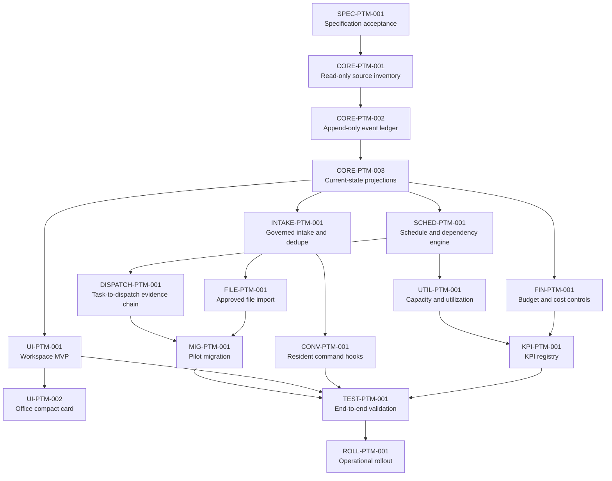

# WP-0659 — Project Management Execution Lane, Parallelism, Campaigns, and Timeline Scenarios

Status: Draft for Chief Architect review  
Prepared: 2026-07-16  
Execution lane: Codex  
Change class: Analysis, decomposition, and planning only

## 1. Purpose

This report converts the current Estate Project and Task Management backlog into an execution-ready delivery plan with explicit lanes, dependency gates, safe parallelism, campaign packaging, and timeline scenarios. It does not implement Project and Task Management runtime code, create a second work-package registry, or grant institutional acceptance.

## 2. Source baseline

Primary source artifacts reviewed:

- `collaboration/work_packages/planning/estate_project_task_management_work_package_backlog.md`
- `collaboration/work_packages/codex_parallel_queue.md`
- `collaboration/work_packages/work_package_range_ledger.json`
- `collaboration/roadmaps/VISUAL-ESTATE-INITIATIVE-WP-4108-4207.md`
- representative pending work packages under `collaboration/work_packages/pending/`
- representative completion receipts under `collaboration/work_packages/completions/` and `collaboration/work_packages/completed/`

## 3. Execution lanes

| Lane | Accountable role | Work type | Entry criteria | Exit criteria |
|---|---|---|---|---|
| Chief Architect decision lane | Chief Architect | Acceptance of specifications, decomposition, canonical boundaries, and sequencing changes | Review packet has source-lined scope, risks, and dependency impact | Approved, revised, parked, or rejected decision recorded |
| Codex implementation lane | Codex | Schemas, deterministic libraries, CLI commands, tests, migration tools, staged Office artifacts | Accepted work package with clear artifacts and dependency gates | Code, tests, evidence, completion receipt, and no parallel institution |
| Codex analysis lane | Codex | Inventory, audit, decomposition, validation reports, non-mutating planning | Analysis package with explicit no-implementation scope | Report committed with assumptions and unresolved questions |
| Office/UI lane | Codex with Chief Architect review | Steward-facing and resident-facing workspace surfaces | Core projections and command contracts exist | Accessible views linked to canonical data without replacing Office |
| Operations/Grace lane | Grace or operations delegate | Rollout, training, monitoring, operating cadence | Tested runtime and Chief Architect-approved runbook | Operational adoption receipt and exception channel |
| Validation lane | Codex/Validation | Replay, regression, policy, evidence, and acceptance checks | Build artifacts exist and validation requirements are listed | Deterministic pass/fail report with blockers preserved |

## 4. Canonical dependency graph

## 5. Campaign packaging

### Campaign PTM-00 — Governance and readiness

- Packages: `SPEC-PTM-001`
- Lane: Chief Architect decision lane
- Can start now: yes
- Parallelism: none; this is the root gate
- Completion evidence: accepted specification boundaries and authorization to begin read-only inventory

### Campaign PTM-01 — Canonical ledger foundation

- Packages: `CORE-PTM-001`, `CORE-PTM-002`, `CORE-PTM-003`
- Lane: Codex analysis then Codex implementation
- Can start after: `SPEC-PTM-001`
- Parallelism: mostly serial; `CORE-PTM-001` inventory categories may be internally parallelized as read-only sub-audits, but `CORE-PTM-002` must wait for adapter contracts and `CORE-PTM-003` must wait for replayable ledger events
- Completion evidence: source inventory, adapter contracts, event schemas, hash-chain tests, deterministic projection rebuild tests

### Campaign PTM-02 — Governed intake and migration feeders

- Packages: `INTAKE-PTM-001`, `FILE-PTM-001`
- Lane: Codex implementation
- Can start after: `CORE-PTM-003`
- Parallelism: partial; file parser fixture research can begin while intake handlers are built, but final import must depend on intake dedupe semantics
- Completion evidence: duplicate detection, confirmation gates, SHA-256 source mappings, accepted/rejected/duplicate reports

### Campaign PTM-03 — Visibility and command surfaces

- Packages: `UI-PTM-001`, `UI-PTM-002`, `CONV-PTM-001`
- Lane: Office/UI plus Codex implementation
- Can start after: `CORE-PTM-003`; `CONV-PTM-001` also waits for `INTAKE-PTM-001`
- Parallelism: safe with branch discipline after shared contracts are frozen; Office compact card waits for workspace deep-link contract
- Completion evidence: navigable workspace, compact Office card, governed resident commands, no private side lists

### Campaign PTM-04 — Scheduling, utilization, financials, and KPIs

- Packages: `SCHED-PTM-001`, `UTIL-PTM-001`, `FIN-PTM-001`, `KPI-PTM-001`
- Lane: Codex implementation with Chief Architect policy review for financial authority boundaries
- Can start after: `CORE-PTM-003`; utilization waits for scheduling; KPIs wait for utilization and financials
- Parallelism: `FIN-PTM-001` can run in parallel with `SCHED-PTM-001`; `UTIL-PTM-001` and `KPI-PTM-001` remain downstream
- Completion evidence: schedule gates, capacity telemetry labels, financial reconciliation reports, KPI stale/unknown protection

### Campaign PTM-05 — Dispatch evidence and pilot migration

- Packages: `DISPATCH-PTM-001`, `MIG-PTM-001`
- Lane: Codex implementation and Validation
- Can start after: `SCHED-PTM-001`; migration waits for dispatch evidence chain and file import
- Parallelism: limited; migration planning can prepare source slices while dispatch integration is implemented
- Completion evidence: task-to-work-package-to-dispatch links, migration source mappings, rollback plan, duplicate handling

### Campaign PTM-06 — Validation and rollout

- Packages: `TEST-PTM-001`, `ROLL-PTM-001`
- Lane: Validation then Operations/Grace lane
- Can start after: all build packages
- Parallelism: validation test authoring can start earlier from accepted contracts; formal acceptance waits for complete build artifacts
- Completion evidence: end-to-end validation report, rollout runbooks, resident training notes, adoption monitoring cadence

## 6. Safe parallel launch matrix

| Package | Earliest launch | Parallel-safe with | Not parallel-safe with | Notes |
|---|---|---|---|---|
| `SPEC-PTM-001` | Now | none | all downstream work | Root acceptance gate. |
| `CORE-PTM-001` | After spec acceptance | internal read-only inventory slices | mutating ledger/projection implementation | Inventory must not mutate sources. |
| `CORE-PTM-002` | After inventory contracts | none significant | `CORE-PTM-003` final build | Event model is a shared foundation. |
| `CORE-PTM-003` | After ledger | UI design mockups using contract stubs | intake, schedule, dispatch final integration | Projection schema must stabilize before consumers. |
| `INTAKE-PTM-001` | After projections | `UI-PTM-001` shell work | `CONV-PTM-001` final commands | Dedupe semantics govern all creation paths. |
| `FILE-PTM-001` | After intake handler contract | `UI-PTM-001`, `SCHED-PTM-001` | `MIG-PTM-001` final migration | Import reports feed migration. |
| `UI-PTM-001` | After projections | intake, file import, finance | `UI-PTM-002` final card | Deep-link contract should be published early. |
| `UI-PTM-002` | After workspace MVP contract | conversation command implementation | workspace navigation churn | Compact card must remain a summary, not a second workspace. |
| `CONV-PTM-001` | After intake | UI compact card | intake schema churn | Commands must use canonical intake paths. |
| `SCHED-PTM-001` | After projections | finance, UI | utilization, dispatch final gates | Critical path semantics govern dispatch readiness. |
| `UTIL-PTM-001` | After scheduling | finance finalization | KPI final formulas | Utilization labels feed KPI quality. |
| `FIN-PTM-001` | After projections | scheduling, UI | KPI final formulas | Keep budget authority boundaries explicit. |
| `KPI-PTM-001` | After utilization and finance | test authoring | rollout | KPIs must preserve unknown/stale data. |
| `DISPATCH-PTM-001` | After scheduling | migration planning | migration execution | Reuse existing dispatch queue. |
| `MIG-PTM-001` | After dispatch and file import | validation test preparation | rollout | Pilot only; no broad migration until accepted. |
| `TEST-PTM-001` | Contract drafting after each package; formal after all builds | most packages as test stubs | rollout acceptance | Test implementation should not redefine contracts. |
| `ROLL-PTM-001` | After validation pass and acceptance | none | unfinished build or validation work | Operational rollout is last. |

## 7. Timeline scenarios

Durations are planning estimates in focused implementation days after each package is authorized and staffed. They exclude external review wait time unless stated.

### Scenario A — Conservative serial path

- Assumption: one Codex implementation worker, strict serial handoff, Chief Architect review after each campaign.
- Estimated duration: 28 to 36 implementation days plus review latency.
- Advantages: lowest merge conflict risk and strongest governance clarity.
- Risks: slow feedback on UI and KPI assumptions.

| Sequence | Campaign | Estimate |
|---|---|---:|
| 1 | PTM-00 Governance and readiness | 1-2 days |
| 2 | PTM-01 Canonical ledger foundation | 7-9 days |
| 3 | PTM-02 Governed intake and migration feeders | 4-5 days |
| 4 | PTM-03 Visibility and command surfaces | 5-7 days |
| 5 | PTM-04 Scheduling/utilization/financials/KPIs | 6-8 days |
| 6 | PTM-05 Dispatch evidence and pilot migration | 3-4 days |
| 7 | PTM-06 Validation and rollout | 2-3 days |

### Scenario B — Balanced parallel path

- Assumption: two to three Codex workers, contract freeze after `CORE-PTM-003`, parallel branches for UI, finance/schedule, and intake/file work.
- Estimated duration: 16 to 22 implementation days plus review latency.
- Advantages: faster delivery while preserving canonical ledger and projection gates.
- Risks: requires explicit schema freeze notes and rebase discipline.

| Window | Work running | Gate to enter next window |
|---|---|---|
| 1 | `SPEC-PTM-001`, then `CORE-PTM-001` | Specification accepted; inventory contracts complete |
| 2 | `CORE-PTM-002` then `CORE-PTM-003` | Event schemas and projections stable |
| 3 | `INTAKE-PTM-001`, `FILE-PTM-001` parser prep, `UI-PTM-001` shell | Intake contract and workspace deep links stable |
| 4 | `SCHED-PTM-001`, `FIN-PTM-001`, `CONV-PTM-001`, `UI-PTM-002` | Schedule gates and command confirmations pass tests |
| 5 | `UTIL-PTM-001`, `KPI-PTM-001`, `DISPATCH-PTM-001`, migration planning | KPI quality rules and dispatch evidence links pass |
| 6 | `MIG-PTM-001`, `TEST-PTM-001`, `ROLL-PTM-001` prep | Pilot accepted and validation pass |

### Scenario C — Aggressive campaign swarm

- Assumption: four or more workers, daily integration, strong maintainer availability, and pre-agreed shared contracts.
- Estimated duration: 10 to 14 implementation days plus review latency.
- Advantages: fastest visible progress.
- Risks: high coordination overhead, duplicate abstractions, merge conflicts, and premature UI/command assumptions.
- Required controls: daily contract freeze bulletin, one owner for ledger/projection schemas, staged UI artifacts until projections stabilize, and mandatory completion receipts before merge.

## 8. Recommended path

Use Scenario B. It keeps `SPEC-PTM-001`, `CORE-PTM-001`, `CORE-PTM-002`, and `CORE-PTM-003` effectively serial because they define institutional truth, then opens parallel work once the projection contract is stable. Scenario C should be reserved for low-risk report/test drafting or when the Chief Architect assigns a dedicated integration owner.

## 9. Immediate next work packages

1. Issue or approve `SPEC-PTM-001` as the root acceptance package.
2. Draft `CORE-PTM-001` as a read-only inventory package with explicit source categories, no mutation, and adapter contract outputs.
3. Prepare contract stubs for `CORE-PTM-002` and `CORE-PTM-003`, but do not launch implementation before inventory contracts are reviewed.
4. Keep the public Codex parallel queue empty for PTM implementation until `CORE-PTM-003` is accepted; after that point, add `UI-PTM-001`, `FIN-PTM-001`, and `SCHED-PTM-001` as candidate parallel launches if their contracts are frozen.

## 10. Risks and mitigations

| Risk | Impact | Mitigation |
|---|---|---|
| Parallel workers create duplicate task registries | Corrupts canonical project management model | Name the append-only event ledger as the only canonical PTM source before implementation starts. |
| UI work starts before projections stabilize | Rework and misleading Office cards | Allow shell/deep-link design only; defer final data binding until `CORE-PTM-003`. |
| Conversational commands bypass governed intake | Hidden task creation paths | Make `CONV-PTM-001` depend on `INTAKE-PTM-001` and require confirmation tests. |
| Financial controls imply delegated budget authority | Governance violation | Require Chief Architect review of financial authority language and tests proving Helen/Grace cannot approve budgets unless separately authorized. |
| Migration imports duplicate or stale artifacts | Poor trust in task ledger | Pilot one slice only, preserve SHA-256 source mappings, and require rollback notes. |
| KPI dashboards flatten unknown data | False operational confidence | KPI rules must label stale, estimated, optional, and unavailable inputs. |

## 11. Completion criteria for this analysis package

WP-0659 is complete when this report is committed with:

- execution lanes;
- campaign grouping;
- dependency graph;
- safe parallel launch matrix;
- conservative, balanced, and aggressive timeline scenarios;
- immediate next-package recommendations;
- no runtime implementation or parallel registry creation.
