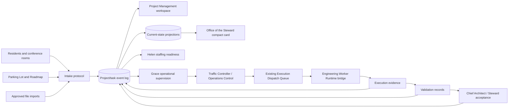
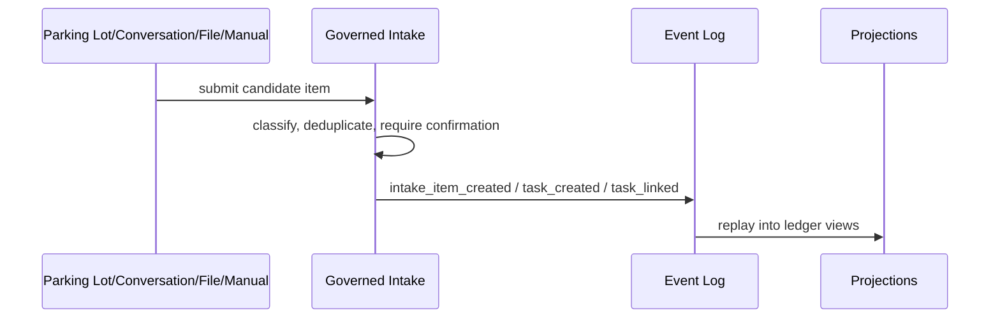
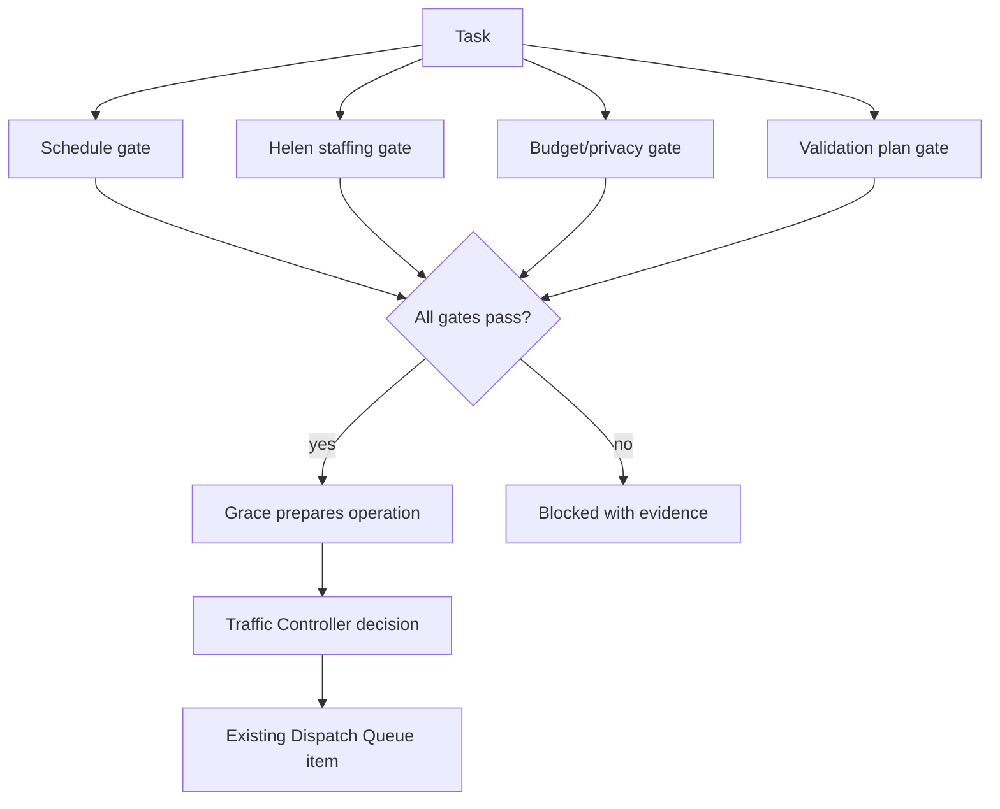

# Estate Project and Task Management Architecture

Status: Specification skeleton. Change class: architecture only.

## Purpose and scope

This architecture defines a single Estate-wide project and task management backbone for planning, branching, scheduling, staffing readiness, operational supervision, dispatch visibility, validation, acceptance, utilization, financials, KPIs, audit, resident interaction, and file intake. It does not implement production code or create a second execution path.

## Authority and boundary model

- The Project Management ledger is the planning and traceability backbone.
- Helen owns personnel, capability assessment, qualifications, staffing readiness, and workforce development.
- Grace owns operational supervision after staffing readiness, including sequencing, scheduling, dispatch preparation, blocker management, retries, escalation, and delivery coordination.
- Traffic Controller and Dispatch retain routing, movement, provider, and execution boundaries.
- Existing Execution Dispatch Queue remains the provider-neutral dispatch queue.
- Engineering Worker Runtime bridge remains the external execution bridge.
- Validation evidence remains distinct from Chief Architect/Steward institutional acceptance.
- Budget authority remains outside Helen and Grace.

## Canonical chain

```text
Project -> Task -> Work Package or bounded execution specification -> Dispatch Attempt -> Execution Evidence -> Validation -> Acceptance
```

A task may exist before a work package. A task may have zero, one, or many work packages, dispatch attempts, branches, validation results, and acceptance decisions.

## System context



## Major data flows

### Intake to planning



### Ready-to-dispatch gating



## Existing Estate integration map

| Component | Treatment | Integration note |
|---|---|---|
| Office of the Steward navigation and command surfaces | Extend lightly | Add compact summary card and deep links only. |
| Parking Lot and Roadmap controls | Reuse | Promotion writes intake events and keeps existing controls canonical for Parking Lot/Roadmap operations. |
| Existing project/work-package views | Extend/project | Link work packages as bounded execution specifications. |
| Resident conversations and conference room | Extend | Governed commands create or modify canonical ledger objects with confirmation and audit. |
| Helen workforce artifacts | Reference | Staffing readiness and qualifications are surfaced as evidence. |
| Grace operations runtime | Reference/extend | Operational events link to tasks; Grace does not become budget or acceptance authority. |
| Traffic Controller / Operations Control decisions | Reuse | Routing and movement decisions remain canonical there. |
| Execution Dispatch Queue | Reuse unchanged | Dispatch attempts reference existing dispatch IDs. |
| Engineering Worker Runtime bridge | Reuse | Execution evidence links to bridge artifacts. |
| Validation and acceptance records | Reference | Validation and acceptance stay separate and are displayed in task detail. |
| Action-result logs, activity streams, audit artifacts | Project | Provide audit timeline and health views. |

## Deployment and surface separation

The dedicated Project Management workspace owns full portfolio/project/task UI. The Office of the Steward receives only active projects, production tasks, blocked work, decisions, recent completions, capacity, 4090 utilization, month-to-date cost, over-budget projects, budget decisions, acceptance wait states, and deep links.

## Required analysis answers

- **Canonical source of truth:** the append-only Project Task Management event log plus immutable referenced evidence. Current tables, cards, and workspace views are projections.
- **Projection rebuild:** projections are deleted and replayed from ordered events, validating schema version, hash chain, and causation references.
- **ID preservation:** IDs are minted once by namespace (`PORT-`, `PROJ-`, `TASK-`, `BRANCH-`, `WP-`, `DISP-`, `INTAKE-`, `KPI-`, `COST-`) and never reused; import mappings, split/merge/branch events preserve source and descendant IDs.
- **References vs canonical objects:** Parking Lot rows, work-package files, dispatch queue rows, runtime evidence, validation reports, and acceptance records remain authoritative in their domains and are referenced by canonical project/task objects rather than copied into a second execution system.
- **Duplicates:** duplicate detection uses normalized title, source hash, source object ID, semantic hints, and human confirmation; duplicates create `duplicate_detected` and optional `merged_into` events, never silent overwrites.
- **Retention:** archive hides from default planning; trash marks reversible removal; restore reverses trash/archive; legal/audit hold prevents purge; immutable events and evidence references remain retained.
- **Helen and Grace visibility:** task detail summarizes staffing readiness and operational supervision with links to evidence, hiding raw implementation noise by default.
- **Provider recommendations:** recommendations are advisory evidence; Traffic Controller/Operations decisions and budget gates authorize provider selection.
- **Dispatch readiness gates:** scheduling, capacity, budget, privacy/classification, validation-plan, read/write-boundary, and acceptance-owner checks must pass before Dispatch becomes Ready.
- **Cost reconciliation:** local and external estimates are evented, actuals are imported or telemetry-derived, and variances reconcile against accepted cost records.
- **KPI protection:** formulas declare required events, freshness, confidence, exclusions, owner, and manipulation controls; unknown values remain unknown.
- **Scale:** workspace relies on indexed projections, virtualized lists, progressive detail disclosure, saved filters, and graph condensation.
- **Branches:** branches are graph overlays on tasks, not deeply nested folders; winning, abandoned, superseded, and merged paths remain visible in a branch graph.
- **Smallest safe pilot:** ingest selected Parking Lot items into a read-only project/task ledger, link one existing work package and dispatch evidence, compute basic cycle-time and audit completeness KPIs, and expose a compact Office card without execution changes.
