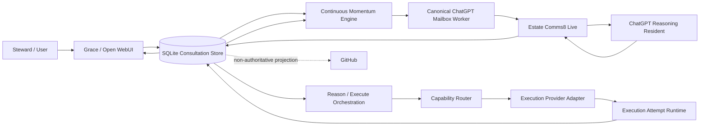
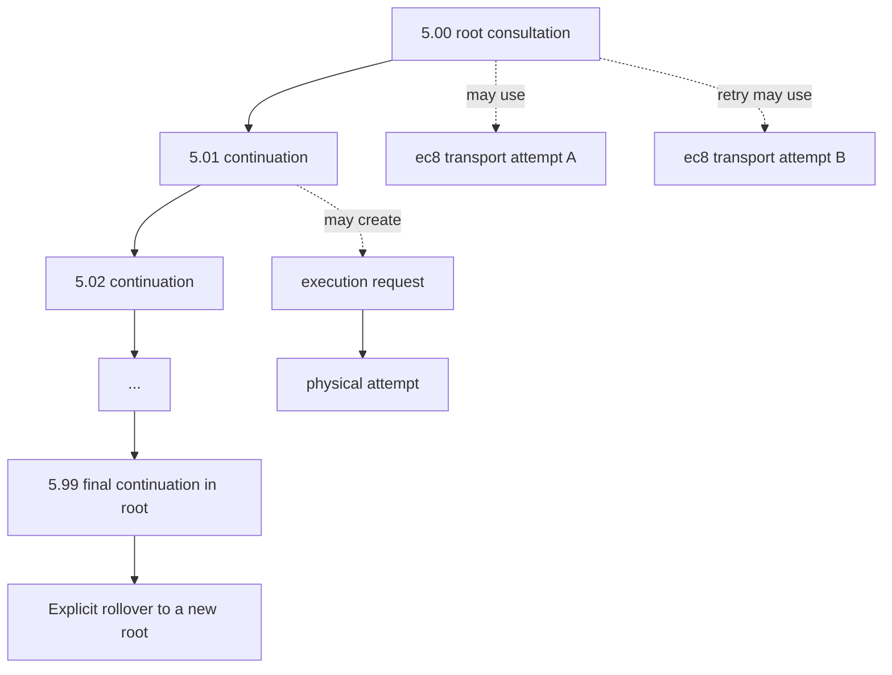
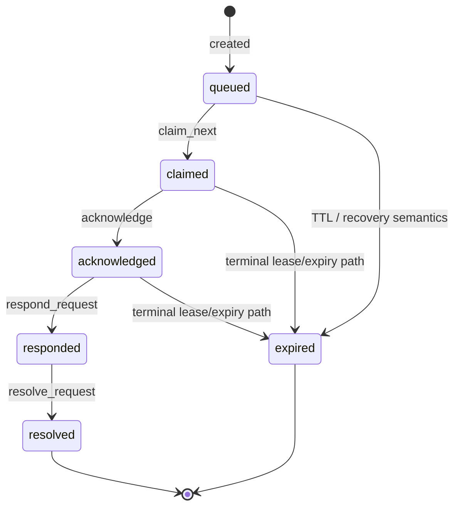
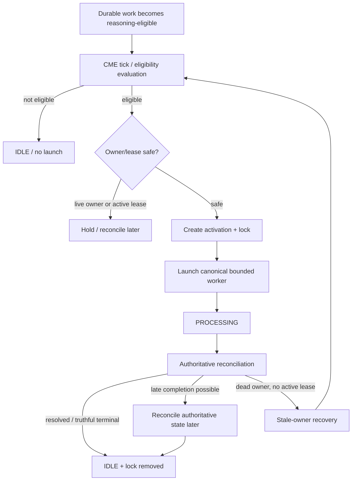
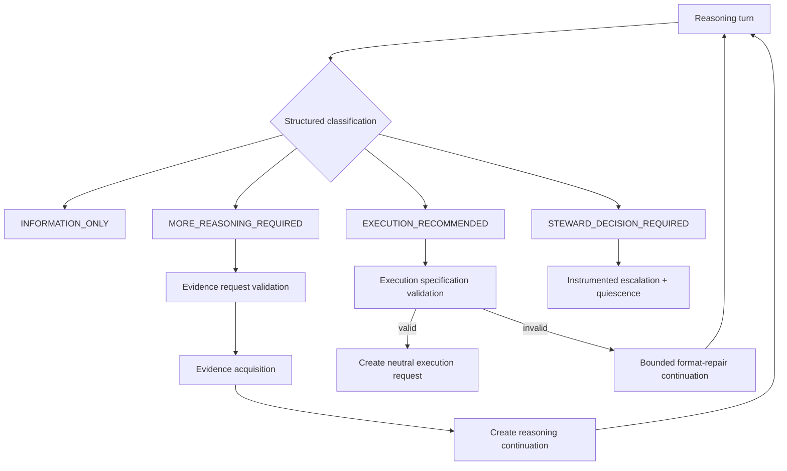
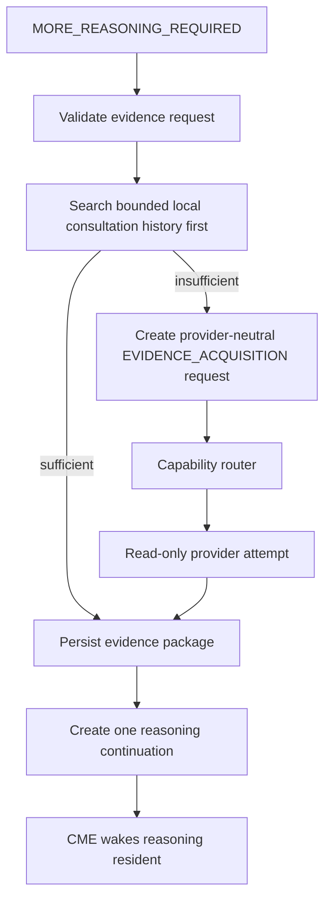
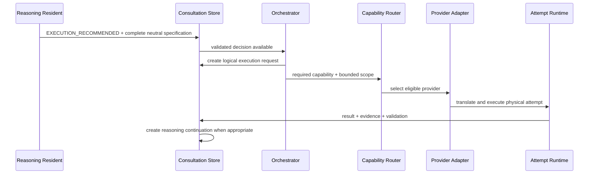
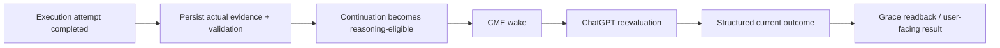
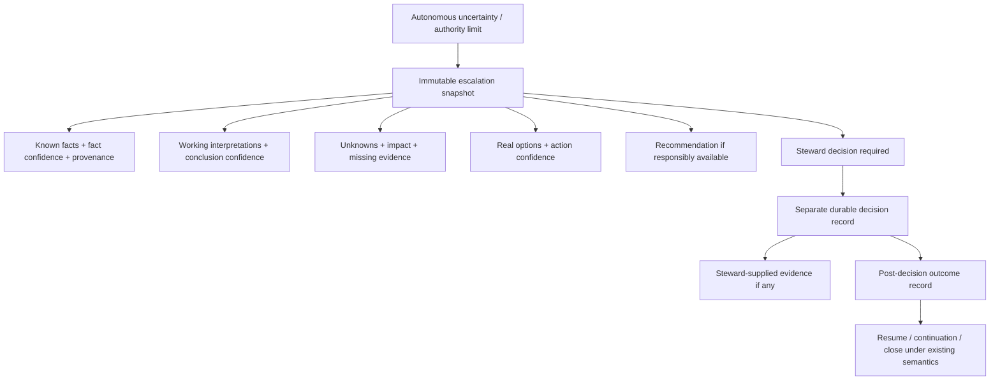
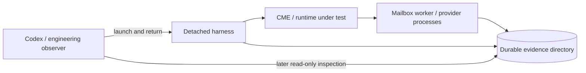

# Estate Grace Reasoning Loop — Implementation and Operations Reference

Status: Current implementation reference  
Classification: Estate Internal  
Date: 2026-08-07

## Purpose

This document is the engineering companion to `ESTATE_Grace_Operational_Reasoning_and_Action_Architecture.md`.

The architecture document explains what the system is. This document explains how the accepted Grace/CME/Comms8/ChatGPT/execution loop fits together operationally, where durable truth lives, what each transition means, and what an engineer should inspect when tracing a consultation.

Historical review receipts remain authoritative evidence for individual repair and acceptance events. This document consolidates the current model so future workers do not have to rediscover the system from those receipts.

## 1. System Topology

The key ownership rule is:

**Grace reasons over durable Estate state. CME owns momentum. Comms8 owns governed transport/lifecycle. SQLite owns logical consultation history. Execution providers own physical attempts.**

## 2. Durable Consultation Identity

Logical reasoning is numbered independently of transport and execution.

The decimal suffix is both lineage and a simple reasoning-cycle counter. It is not a transport-attempt counter and not an execution-attempt counter.

### Canonical local store

`A:\theestate-data\consultations\consultations.db`

The store can preserve, as applicable:

- root and continuation identities;
- question/objective;
- structured reasoning response;
- validation state;
- `ec8-*` transport correlation;
- transport-attempt history;
- execution requests and physical attempts;
- evidence and validation;
- PTM/project references;
- tags;
- escalation/decision/outcome records;
- projection status.

A physical ChatGPT or Open WebUI conversation is not the authoritative history.

## 3. Comms8 Transport Lifecycle

The authoritative lifecycle is Comms8 state, not browser prose.

A visible `WORKER_COMPLETE` or stable assistant response does not prove `responded` or `resolved`. The accepted runtime has already demonstrated late authoritative completion after browser-side completion appeared first.

## 4. CME Ownership and Wakeup

Accepted safety properties:

- CME is the normal owner of ChatGPT reasoning activation.
- Manual mailbox-worker launch is diagnostic/recovery, not normal operation.
- Repeated ticks must not launch duplicate workers.
- A live owner must not be cleared.
- An active authoritative lease blocks unsafe stale-owner recovery.
- Dead recorded owner state can be reclaimed only when the durable work remains eligible and authoritative transport state makes recovery safe.
- Failed activation history is preserved separately from successful replacement activation.

## 5. Canonical ChatGPT Worker Boundary

The canonical worker runs in the governed Open WebUI Python environment and uses the generic mailbox contract rather than a Steward-injected request ID.

The worker must:

1. prove the ChatGPT target is authenticated and usable;
2. prove the Estate Comms8 Live app/action set is available;
3. claim only eligible work using the canonical worker identity;
4. process one authoritative request;
5. preserve structured reasoning output;
6. reconcile authoritative lifecycle before declaring completion;
7. refuse duplicate work when an active lease already exists.

### Browser completion

Generation-start and generation-completion timing are separate. The accepted completion window is deliberately longer than short DOM waits so a healthy long-running generation is not falsely classified as failed.

Robust completion uses multiple signals such as assistant-message stability, tool-card state, generation controls, navigation/target state, and final authoritative Comms8 reconciliation.

## 6. Structured Reasoning Decision Boundary

Execution authority is never inferred from prose.

A valid execution recommendation must carry the canonical provider-neutral specification, including the accepted equivalents of:

- objective;
- required capability;
- allowed scope;
- prohibited scope;
- evidence requirements;
- validation criteria;
- consultation correlation.

Missing required fields fail closed. The validator is not weakened; a bounded reasoning-format continuation may repair the specification without reacquiring already-sufficient evidence.

## 7. Evidence Acquisition

Important rules:

- the evidence-request specification cannot satisfy itself;
- evidence acquisition is separate from execution recommendation;
- acquisition is read-only unless a different accepted contract explicitly applies;
- the current accepted root budget is three provider acquisitions;
- no fourth acquisition is created after the limit;
- exhausting the budget can lead to truthful escalation rather than fabricated closure.

## 8. Execution Provider Handoff

The surrounding system asks for a capability, not a Codex identity. `codex-cli-openai` may currently satisfy a capability, but provider-specific translation belongs inside the adapter.

Logical execution requests and physical attempts are separately durable so retries do not erase the original intent.

## 9. Observe -> Reason Again

Execution completion is not the end of the consultation.

The reasoning resident must evaluate what actually happened, including hidden constraints discovered during execution. A failed or partial execution may require retry, more evidence, a reasoning continuation, or Steward escalation depending on the accepted contract.

## 10. Instrumented Steward Escalation

Confidence values are operational evidence-strength signals, not statistically calibrated probabilities unless calibration is later established.

The escalation corpus is intended for future analysis of why autonomy stopped, not for automatic expansion of authority.

## 11. GitHub Projection

GitHub is a secondary durable projection for human inspection and archival continuity.

Projection should be:

- idempotent;
- non-blocking;
- bounded;
- free of secrets;
- correlated to the logical consultation;
- clearly non-authoritative relative to local durable state and governed lifecycle truth.

Failure to publish must not stop local reasoning, execution, or escalation.

## 12. Detached Process-Ownership Test Boundary

CME/process-ownership tests exposed a real observer-effect problem when Codex synchronously hosted the process tree being tested. The accepted method separates the observer from the system under test.

Codex is the observer; it must not be the parent whose survival defines the runtime acceptance.

The detached harness persists run identity, PIDs, stdout/stderr, exit status, timestamps, and completion markers so evidence survives independent of the interactive command runner.

## 13. Known Operational Truth Hierarchy

When two surfaces disagree, prefer the authoritative source for the claim being made.

1. **Consultation logical history:** SQLite consultation store.
2. **Comms8 request lifecycle:** authoritative Comms8 record/events.
3. **Execution result:** execution attempt/evidence/validation records.
4. **CME ownership:** durable CME owner/activation/lock state plus real process existence.
5. **Browser UI:** evidence of user-facing interaction, but not authoritative lifecycle completion by itself.
6. **GitHub projection:** durable human-readable mirror, not runtime authority.

## 14. Trace One Consultation End to End

Given a root such as `9.00`, reconstruct in this order:

1. Load the root and all continuations from the consultation store.
2. Read associated Comms8 transport-attempt identities and lifecycle events.
3. Read structured reasoning decisions for each turn.
4. Read evidence requests/acquisitions and their execution requests/attempts.
5. Read logical execution requests and physical attempts separately.
6. Read execution evidence and validation criteria/results.
7. Confirm which evidence caused the next continuation.
8. Read CME activation records for each reasoning wake.
9. Confirm final Grace readback/current consultation state.
10. Read GitHub projection only as a secondary human-readable representation.

This order avoids using browser text or projection artifacts as substitutes for authoritative durable state.

## 15. Activation / Restart Matrix

There is no universal restart after a change. Every work package must explicitly classify activation requirements.

Typical boundaries:

- changed long-lived Grace/Gateway code -> Grace Gateway restart may be required;
- changed mailbox-worker code -> bounded worker relaunch is required on next activation, but CME remains normal owner;
- changed CME owner code -> owning long-lived CME/runtime process may require restart;
- changed Open WebUI runtime/middleware -> Open WebUI restart required;
- browser-only stale state -> Ctrl+F5 or new conversation may be sufficient;
- provider adapter/router code -> relaunch only the separately supervised provider/router if needed;
- Comms8/MCP/Runtime Host/workstation restart -> not implied; require evidence.

The operational rule is **smallest activation boundary**.

## 16. Current Proven Acceptance

The controlled fixture rooted at `9.00` proved the complete single-lane autonomous circle:

- Grace-originated natural intent;
- CME-owned ChatGPT reasoning;
- bounded evidence acquisition;
- reasoning-format repair of malformed execution recommendations;
- complete provider-neutral `EXECUTION_RECOMMENDED` specification;
- one logical execution request;
- one physical provider attempt;
- fixture-only mutation;
- deterministic validation;
- automatic reasoning continuation;
- CME-owned ChatGPT reevaluation;
- authoritative `INFORMATION_ONLY` current conclusion;
- Grace outcome persistence;
- CME `IDLE`, no lock, duplicate tick `EMPTY_QUEUE`.

## 17. Deliberate Non-Goals at This Checkpoint

Not yet implemented as full Estate capabilities:

- broad multi-root parallel scheduling;
- provider-seat/capacity orchestration;
- Estate-wide resident-neutral work portfolio;
- automatic prioritization across deadlines/dependencies/resources;
- completed Character Architecture restoration for Grace;
- Estate-wide cookbook troubleshooting and automated diagnostic tooling.

The current code should preserve hooks for these without implementing them inside unrelated work packages.

## 18. Troubleshooting Philosophy — Future Work

The Estate is now large enough that future recovery must stop relying on rediscovery.

A separate Parking Lot effort should define Estate-wide operational checkpoints and cookbook diagnostics influenced by disciplined input/output troubleshooting practice, including the U.S. Navy seven-step troubleshooting tradition as a methodology to study and adapt rather than copy blindly.

The future diagnostic model should let an operator say, in effect:

`the workflow proved checkpoint 4.71 but did not prove 4.72`

and immediately know:

- expected input;
- expected output;
- authoritative evidence source;
- measurements to inspect;
- known failure classifications;
- safe recovery action;
- what not to restart;
- verification required before declaring recovery.

This is intentionally not implemented in this documentation checkpoint.